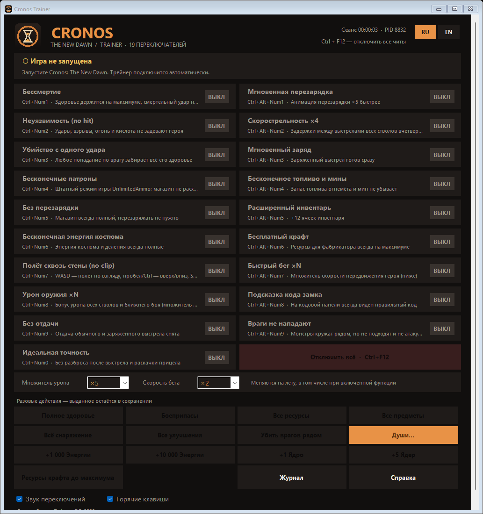
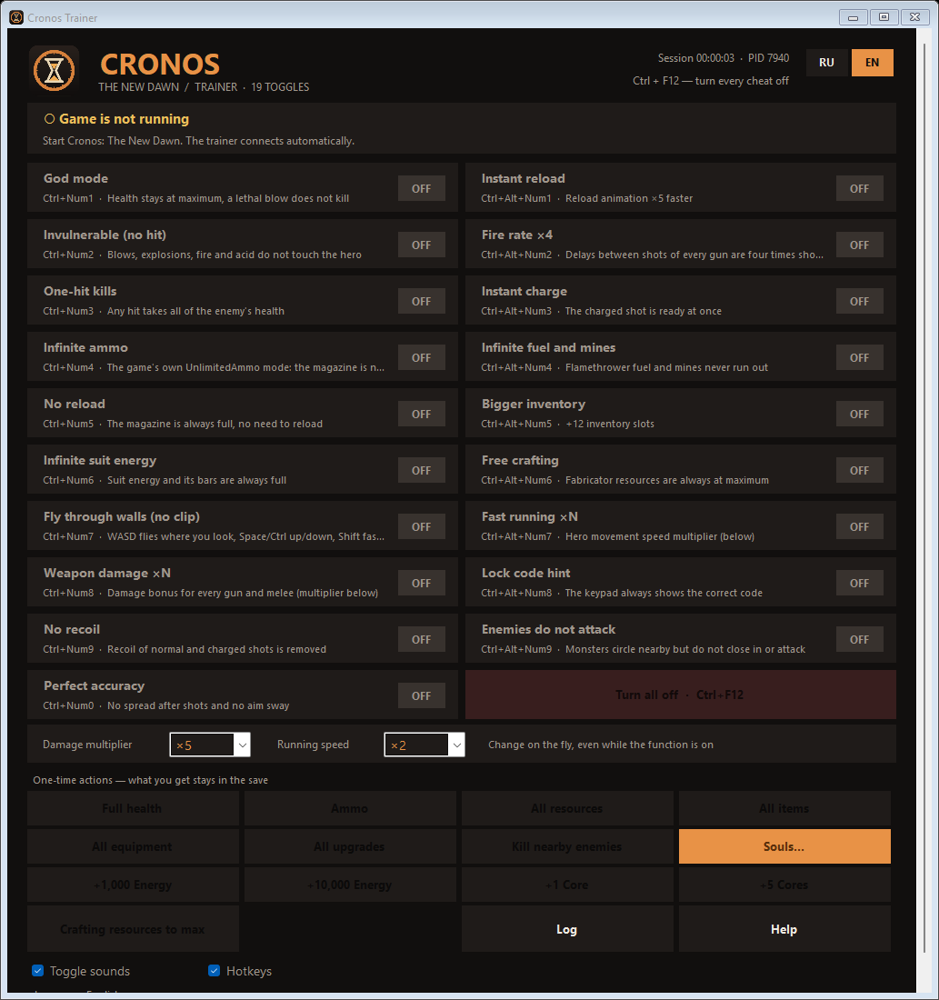

# Cronos Trainer

[Русский](#русский) · [English](#english)

Трейнер для одиночной игры **Cronos: The New Dawn** (Bloober Team, Unreal Engine 5.5, Windows x64). 19 функций, Энергия, Ядро и ресурсы, души, интерфейс на русском и английском с переключением на лету.



---

## Русский

### Что это

Внешняя программа: при подключении загружает в игру небольшой мост `CronosBridge.dll`. Мост перехватывает `UObject::ProcessEvent` и выполняет команды трейнера в игровом потоке через функции и данные самой игры: компонент здоровья героя, флаги `MaiHealth` врагов, тег `UnlimitedAmmo`, характеристики GAS (`CronosUpgradeSet`, `CronosSoulPerkSet`), параметры режимов стрельбы, функцию предметов `CollectItem` и встроенные функции разработчиков (`GiveAllItems`, `KillAll`, `AddSoul`).

Только для одиночной игры. Трейнер не трогает защиту игры, сеть и файлы на диске.

### Установка и запуск

1. Скачайте `CronosTrainer.exe` из [релизов](https://github.com/jestelf/CronosTrainer/releases).
2. Запустите игру и загрузите сохранение.
3. Запустите трейнер — он подключится сам (порядок запуска не важен).

Если трейнер показывает «Нет доступа к процессу игры», запустите его от имени администратора. Журнал и настройки — в `%LOCALAPPDATA%\CronosTrainer`. Окно прокручивается, если не помещается по высоте экрана.

### Функции и горячие клавиши

`Ctrl+F12` — отключить всё. Язык переключается кнопками **RU / EN** в правом верхнем углу.

| Клавиши | Функция | Что делает |
|---|---|---|
| Ctrl+Num1 | Бессмертие | Здоровье держится на максимуме, смертельный удар не убивает |
| Ctrl+Num2 | Неуязвимость (no hit) | Удары монстров проходят сквозь героя; взрывы, огонь и кислота не наносят урона |
| Ctrl+Num3 | Убийство с одного удара | Любое попадание по врагу забирает всё его здоровье |
| Ctrl+Num4 | Бесконечные патроны | Штатный режим игры UnlimitedAmmo |
| Ctrl+Num5 | Без перезарядки | Магазин всегда полный |
| Ctrl+Num6 | Бесконечная энергия костюма | Энергия костюма и деления всегда полные |
| Ctrl+Num7 | Полёт сквозь стены (no clip) | WASD — полёт по взгляду камеры, пробел/Ctrl — вверх/вниз, Shift — быстрее |
| Ctrl+Num8 | Урон оружия ×N | Бонус урона всех стволов и ближнего боя (×2–25) |
| Ctrl+Num9 | Без отдачи | Отдача обычного и заряженного выстрела снята |
| Ctrl+Num0 | Идеальная точность | Без разброса и раскачки прицела |
| Ctrl+Alt+Num1 | Мгновенная перезарядка | Анимация перезарядки ×5 быстрее |
| Ctrl+Alt+Num2 | Скорострельность ×4 | Задержки между выстрелами вчетверо короче |
| Ctrl+Alt+Num3 | Мгновенный заряд | Заряженный выстрел готов сразу |
| Ctrl+Alt+Num4 | Бесконечное топливо и мины | Запас топлива огнемёта и мин не убывает |
| Ctrl+Alt+Num5 | Расширенный инвентарь | +12 ячеек |
| Ctrl+Alt+Num6 | Бесплатный крафт | Ресурсы фабрикатора всегда на максимуме |
| Ctrl+Alt+Num7 | Быстрый бег ×N | Скорость героя ×1.5–3 |
| Ctrl+Alt+Num8 | Подсказка кода замка | На кодовой панели всегда виден правильный код |
| Ctrl+Alt+Num9 | Враги не нападают | Монстры кружат рядом, но не подходят и не атакуют |

**Разовые действия** (результат остаётся в сохранении): полное здоровье, боеприпасы, все ресурсы, все предметы, всё снаряжение, все улучшения, убить врагов рядом, **+1 000 / +10 000 Энергии**, **+1 / +5 Ядер**, ресурсы крафта до максимума, окно **душ** (добавить или убрать душу из таблицы игры).

Выключение функции возвращает исходные значения игры; закрытие трейнера выключает все функции. Функции характеристик лучше выключать перед сохранением.

### Поддерживаемая версия

Cronos: The New Dawn, GOG-сборка 1.4.0.0 (`Cronos-Win64-Shipping.exe` от 12.02.2026). При другой версии трейнер покажет «Другая версия игры» и не подключится — так безопаснее, чем писать в чужую сборку.

### Что проверено

Подтверждено автором в игре на этой сборке: бессмертие, no hit против ударов монстров, «Враги не нападают», бесконечные патроны и перезарядка, начисление Энергии, Ядра и ресурсов. Остальные функции проверены по значениям в памяти игры во время разработки; защита no hit от взрывов, огня и кислоты и подсказка кода замка проверены меньше других. Если что-то не срабатывает, откройте issue и приложите строку из журнала трейнера.

### Антивирусы

Трейнер загружает DLL в процесс игры, поэтому некоторые антивирусы могут ругаться эвристически. Исходники открыты, exe можно собрать самостоятельно.

### Сборка

Нужны .NET Framework 4.x (`csc.exe` входит в Windows) и Visual Studio Build Tools с компилятором C++ x64.

```powershell
powershell -ExecutionPolicy Bypass -File build.ps1
powershell -ExecutionPolicy Bypass -File build.ps1 -VcVars "C:\Program Files\Microsoft Visual Studio\2022\BuildTools\VC\Auxiliary\Build\vcvars64.bat"
```

Результат — `dist\CronosTrainer.exe` (мост встраивается в exe).

### Лицензия

MIT. Проект не связан с Bloober Team.

---

## English



### What it is

An external trainer for the single-player **Cronos: The New Dawn** (Bloober Team, Unreal Engine 5.5, Windows x64): 19 functions, Energy, Core and resources, souls, RU/EN interface with live switching. On connection it loads a small bridge `CronosBridge.dll` into the game. The bridge hooks `UObject::ProcessEvent` and runs trainer commands on the game thread through the game's own functions and data: the hero's health component, the `MaiHealth` flags of enemies, the `UnlimitedAmmo` tag, GAS attributes (`CronosUpgradeSet`, `CronosSoulPerkSet`), weapon fire mode parameters, the `CollectItem` item function and built-in developer functions (`GiveAllItems`, `KillAll`, `AddSoul`).

Single-player only. The trainer does not touch the game's protection, networking or files on disk.

### Install and run

1. Download `CronosTrainer.exe` from [releases](https://github.com/jestelf/CronosTrainer/releases).
2. Start the game and load a save.
3. Start the trainer — it connects by itself (launch order does not matter).

If the trainer reports no access to the game process, run it as administrator. Log and settings live in `%LOCALAPPDATA%\CronosTrainer`. The window scrolls if it does not fit the screen height.

### Functions and hotkeys

`Ctrl+F12` turns everything off. Switch the language with the **RU / EN** buttons in the top right corner.

| Keys | Function | What it does |
|---|---|---|
| Ctrl+Num1 | God mode | Health stays at maximum, a lethal blow does not kill |
| Ctrl+Num2 | Invulnerable (no hit) | Monster blows pass through the hero; explosions, fire and acid deal no damage |
| Ctrl+Num3 | One-hit kills | Any hit takes all of the enemy's health |
| Ctrl+Num4 | Infinite ammo | The game's own UnlimitedAmmo mode |
| Ctrl+Num5 | No reload | The magazine is always full |
| Ctrl+Num6 | Infinite suit energy | Suit energy and its bars are always full |
| Ctrl+Num7 | Fly through walls (no clip) | WASD flies where the camera looks, Space/Ctrl up/down, Shift faster |
| Ctrl+Num8 | Weapon damage ×N | Damage bonus for every gun and melee (×2–25) |
| Ctrl+Num9 | No recoil | Recoil of normal and charged shots is removed |
| Ctrl+Num0 | Perfect accuracy | No spread and no aim sway |
| Ctrl+Alt+Num1 | Instant reload | Reload animation ×5 faster |
| Ctrl+Alt+Num2 | Fire rate ×4 | Delays between shots are four times shorter |
| Ctrl+Alt+Num3 | Instant charge | The charged shot is ready at once |
| Ctrl+Alt+Num4 | Infinite fuel and mines | Flamethrower fuel and mines never run out |
| Ctrl+Alt+Num5 | Bigger inventory | +12 slots |
| Ctrl+Alt+Num6 | Free crafting | Fabricator resources are always at maximum |
| Ctrl+Alt+Num7 | Fast running ×N | Hero speed ×1.5–3 |
| Ctrl+Alt+Num8 | Lock code hint | The keypad always shows the correct code |
| Ctrl+Alt+Num9 | Enemies do not attack | Monsters circle nearby but do not close in or attack |

**One-time actions** (results stay in the save): full health, ammo, all resources, all items, all equipment, all upgrades, kill nearby enemies, **+1,000 / +10,000 Energy**, **+1 / +5 Cores**, crafting resources to max, the **souls** window (add or remove a soul from the game's table).

Turning a function off restores the game's original values; closing the trainer turns everything off. Turn attribute functions off before saving.

### Supported version

Cronos: The New Dawn, GOG build 1.4.0.0 (`Cronos-Win64-Shipping.exe` from 2026-02-12). On another version the trainer reports a different game version and does not connect — safer than writing into an unknown build.

### What is verified

Confirmed by the author in game on this build: god mode, no hit against monster blows, "Enemies do not attack", infinite ammo and no reload, adding Energy, Core and resources. The other functions were checked against the game's memory during development; the explosion, fire and acid protection of no hit and the lock code hint were tested less than the rest. If something does not work, open an issue with the line from the trainer log.

### Antivirus

The trainer loads a DLL into the game process, so some antivirus products may raise heuristic warnings. The source is open and you can build the exe yourself.

### Build

Requires .NET Framework 4.x (`csc.exe` ships with Windows) and Visual Studio Build Tools with the x64 C++ compiler.

```powershell
powershell -ExecutionPolicy Bypass -File build.ps1
powershell -ExecutionPolicy Bypass -File build.ps1 -VcVars "C:\Program Files\Microsoft Visual Studio\2022\BuildTools\VC\Auxiliary\Build\vcvars64.bat"
```

Output: `dist\CronosTrainer.exe` (the bridge is embedded in the exe).

### License

MIT. Not affiliated with Bloober Team.
